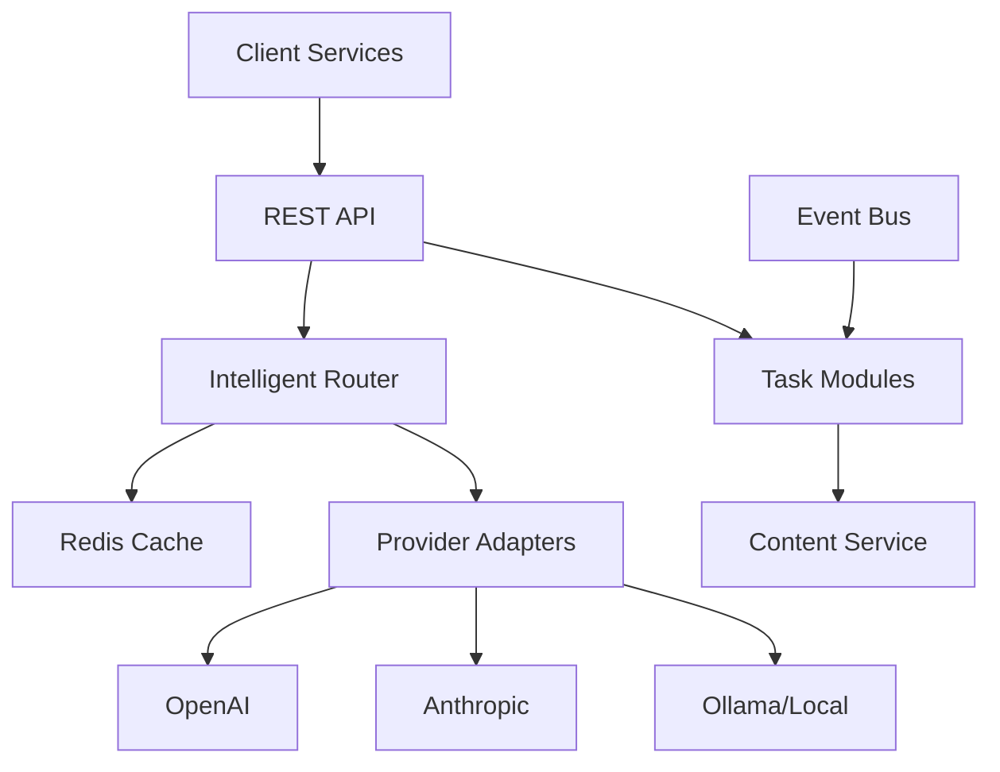

# AI Service

Multi-provider LLM orchestration service with intelligent routing, caching, and budget management.

## Features

- **Multi-Provider Support**: OpenAI, Anthropic, Ollama (local models)
- **Intelligent Routing**: Task-based model selection with fallbacks
- **Caching**: Redis-based response caching with TTL
- **Budget Management**: Per-service cost tracking and limits
- **Task Modules**: Summarization, classification, extraction, embeddings
- **Event Integration**: AsyncAPI for event-driven workflows
- **Observability**: Prometheus metrics, structured logging, OpenTelemetry

## Quick Start

### Development

```bash
# Install dependencies
npm install

# Copy environment variables
cp .env.example .env
# Edit .env with your API keys

# Start development server
npm run dev
```

### Docker

```bash
# Start all services
docker-compose up -d

# Pull Ollama models
make ollama-pull

# View logs
docker-compose logs -f ai-service

# Stop services
docker-compose down
```

## API Endpoints

### Core Operations

- `POST /v1/summarize` - Summarize text or documents
- `POST /v1/classify` - Classify text with labels/taxonomy
- `POST /v1/extract` - Extract structured data from text
- `POST /v1/embed` - Generate embeddings for text
- `POST /v1/agent/run` - Execute named agents

### Health & Monitoring

- `GET /health` - Health check
- `GET /ready` - Readiness probe
- `GET /metrics` - Prometheus metrics

## Configuration

### Environment Variables

```bash
# Server
PORT=3000
LOG_LEVEL=info

# Redis Cache
REDIS_URL=redis://localhost:6379

# Providers
OPENAI_API_KEY=sk-...
ANTHROPIC_API_KEY=sk-ant-...
OLLAMA_HOST=http://localhost:11434

# Security
ALLOWED_SERVICES=finance,trading,content
```

### Routing Policies

Edit `src/policies/routing.yaml` to configure:
- Provider preferences
- Model selection per task
- Budget limits per service
- Confidence thresholds

## Examples

### Summarize Text

```bash
curl -X POST http://localhost:3000/v1/summarize \
  -H "Content-Type: application/json" \
  -H "X-API-Key: test" \
  -H "X-Service: finance" \
  -d '{
    "input": "Long text to summarize...",
    "size": "medium",
    "style": "executive"
  }'
```

### Classify Transaction

```bash
curl -X POST http://localhost:3000/v1/classify \
  -H "Content-Type: application/json" \
  -H "X-API-Key: test" \
  -H "X-Service: finance" \
  -d '{
    "input": "MERCADONA VALENCIA",
    "taxonomyId": "expenses.v1",
    "autoTag": true
  }'
```

### Extract Invoice Data

```bash
curl -X POST http://localhost:3000/v1/extract \
  -H "Content-Type: application/json" \
  -H "X-API-Key: test" \
  -H "X-Service: finance" \
  -d '{
    "input": "Invoice text...",
    "schema": {
      "type": "object",
      "properties": {
        "total": {"type": "number"},
        "date": {"type": "string"},
        "vendor": {"type": "string"}
      }
    }
  }'
```

## Development

### Project Structure

```
src/
├── core/           # Core routing, caching, policies
├── providers/      # LLM provider adapters
├── modules/        # Task implementations
├── routes/         # REST API endpoints
├── integrations/   # External service clients
└── policies/       # YAML configuration files
```

### Testing

```bash
# Run unit tests
npm test

# Run with coverage
npm run test:coverage

# Run evaluations
npm run evals
```

### Adding a New Provider

1. Create adapter in `src/providers/`
2. Implement `Provider` interface
3. Add to `router.ts` initialization
4. Update `routing.yaml` configuration

## Architecture



## License

Private - All rights reserved